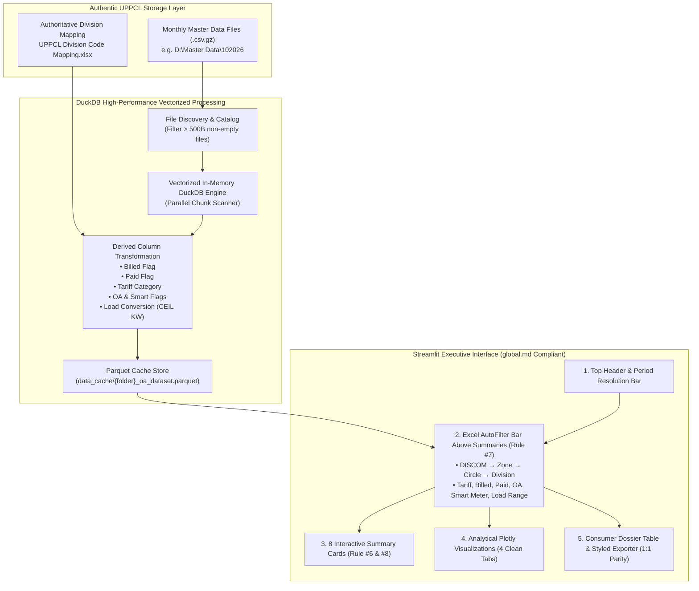

# Technical Design & User Operating Manual
## Open Access Consumers & Billing Revenue Analysis Dashboard (Version 2.0.0)

---

### 1. Architecture Overview & Redesigned Layout



---

### 2. Implementation of Universal Agent Rules (`global.md`)

#### 2.1 Rule #7: Contextual Dropdown Filters with Checkboxes Above Summaries
- **Horizontal Placement:** All administrative and operational filters are positioned directly above the summary indicators in a clean, uncluttered two-row grid, completely removing sidebar clutter.
- **Top Search Box (Excel AutoFilter Standard):** Positioned permanently at the top of each filter popover for instantaneous searching.
- **`(Select All Search Results)` & `Add current selection to filter`:** Enables searching and selective or incremental merging without clearing out-of-scope selections.
- **`(Select All)` Checkbox:** Master toggle when search is empty, with real-time total option counts.
- **Independent State Isolation:** Toggling selections inside one dropdown never corrupts or invalidates selections in other dimensions.
- **Status Badges:** Each filter button displays real-time status badges: `(All)`, `(None)`, or `(3/15)`.

#### 2.2 Rule #6: Summary Hyperlinks & Strict 1:1 Count Parity
- Clicking any of the 8 KPI summary cards toggles an active isolation filter on the consumer dossier table below.
- Active card is highlighted with a blue border glow.
- Strict 1:1 count parity is verified programmatically and displayed on the table header badge before any file download.

#### 2.3 Rule #8: Indian Number Formatting
- Centralized formatting using `format_in()` and `format_currency_dual()` applies `en-IN` comma grouping (`1,00,000`, `10,00,000`, `1,00,00,000`) across all cards, charts, table columns, and exports.

---

### 3. User Operating Manual

#### 3.1 Launching the Application
Execute the one-click batch launcher:
```powershell
d:\AG Project\Open Access\run_dashboard.bat
```
Or run directly via command line:
```powershell
python -m streamlit run app.py --server.port 8503
```
Open `http://localhost:8503` in your web browser.

#### 3.2 Selecting Master Data
1. **Browse Folder:** Click **📂 Browse** to launch the Windows native folder picker, or type any valid master data folder path (e.g., `D:\Master Data\102026`).
2. **Auto-Extracted Month & Year:** The dashboard automatically extracts the first 2 digits as Master Month and the last 4 digits as Master Year.
3. **Load Data:** Click **🚀 Load Data** to ingest and process records.

#### 3.3 Operating the Excel AutoFilter Bar Above Summaries
1. Click any filter button (e.g., **DISCOM: (All)** or **Division: (All)**) to open the AutoFilter popover.
2. Type in the search box to find specific entities.
3. Check individual items or use `(Select All Search Results)` / `(Select All)`.
4. Click **🔄 Reset** to restore all filters to the default `(All)` state.

#### 3.4 Interactive Drilldown & 1:1 Parity Exports
1. Click **🔗 View All Consumers**, **🔗 Filter Billed Only**, **🔗 Filter Unbilled Only**, or **🔗 Filter Paying Only** to filter the dossier table.
2. Search consumer names or accounts in the table search bar.
3. Click **📥 Download Exact Records as Excel (.xlsx)** or **CSV** to download qualifying records matching the displayed summary count.
