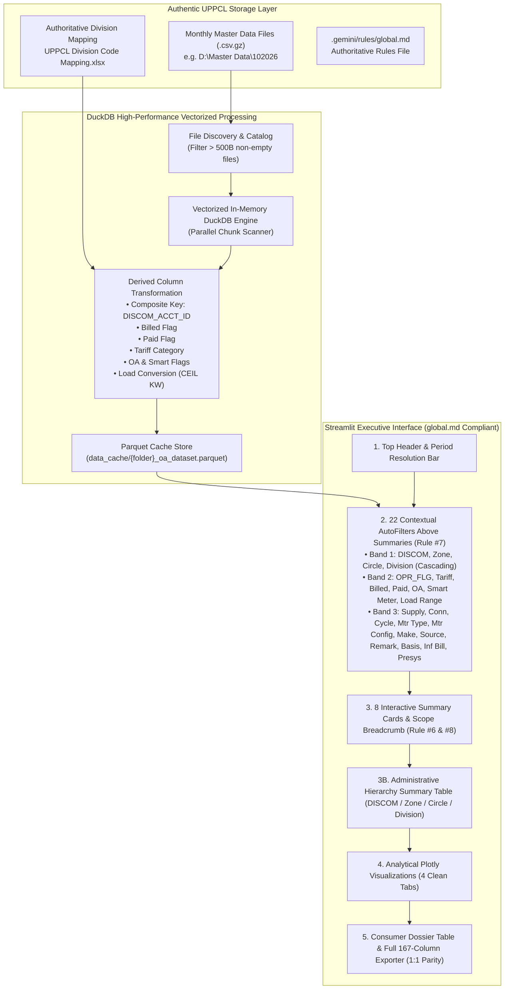

# Technical Design & User Operating Manual
## Open Access Consumers & Billing Revenue Analysis Dashboard (Version 4.0.0)

---

### 1. Architecture Overview & global.md Standards



---

### 2. Exact Implementation of Rule #7 (Excel AutoFilter Semantics)

The filter engine implements Microsoft Excel AutoFilter semantics down to the exact paragraph of `global.md`:
1. **Adjacent Checkboxes:** Display individual checkboxes positioned immediately adjacent to each option.
2. **Default State — All Checked (with Targeted Pre-selections):** Default to all options checked (`value=True`) initially so the entire dataset is in scope. For domain-targeted initial scopes (such as Open Access), corresponding filters (`5. OPR_FLAG = ['Y']` and `9. OA Config = ['YES']`) are pre-selected to immediately present the 526 active Open Access consumers, while remaining fully configurable.
3. **Instant Zero-Latency Synchronization:** Synchronizes incoming Streamlit widget states into the selection state dictionary prior to badge formatting and data filtering, ensuring every filter change is instantaneously reflected without waiting for subsequent filter interactions.
4. **Top Search Box:** Positioned permanently at the top of each popover.
4. **Manual Search Selection with Explicit Add-to-Filter Branching:**
   - Newly matching options and `(Select All Search Results)` are presented **unchecked by default**.
   - If `Add current selection to filter` is unchecked (default): Isolates strictly to the newly selected search items.
   - If `Add current selection to filter` is checked: Merges the persistent committed base snapshot with newly selected search items.
5. **Persistent Committed Base Snapshot:** Captured before a search query begins and preserved across consecutive searches.
6. **Pure Master Checkbox Bulk Selection:** Driven exclusively via `(Select All)` or `(Select All Search Results)`.
7. **Independent Filter State Isolation:** Master checkboxes and toggles operate strictly on that dropdown's options without affecting other filters.
8. **Universal Cascading:** Full omnidirectional cascading across all 22 filters.

---

### 3. Administrative Hierarchy Summary with Multi-Level Subtotals

The Administrative Summary table provides hierarchical aggregation conforming to Universal Agent Rules #4, #6, and #8:
1. **Upper-Level Hierarchy Display:** When summarizing down to any administrative tier (Division, Circle, Zone, or DISCOM), all parent hierarchy columns are retained in the summary view (e.g., Division level displays `DISCOM`, `ZONE_NAME`, `CIRCLE_NAME`, `DIVISION_NAME`).
2. **Multi-Level Subtotals:**
   - **Division Tier:** Displays Division rows, Circle Subtotals (`★ Subtotal (Circle)`), Zone Subtotals (`★★ Subtotal (Zone)`), DISCOM Subtotals (`★★★ Subtotal (DISCOM)`), and Grand Total (`★★★★ GRAND TOTAL`).
   - **Circle Tier:** Displays Circle rows, Zone Subtotals (`★ Subtotal (Zone)`), DISCOM Subtotals (`★★ Subtotal (DISCOM)`), and Grand Total (`★★★ GRAND TOTAL`).
   - **Zone Tier:** Displays Zone rows, DISCOM Subtotals (`★ Subtotal (DISCOM)`), and Grand Total (`★★ GRAND TOTAL`).
   - **DISCOM Tier:** Displays DISCOM rows and Grand Total (`★ GRAND TOTAL`).
3. **Reconciled Grand Total:** The bottom Grand Total row reconciles 100% with all 8 KPI cards and the authentic filtered master dataset.
4. **Styled Excel Export:** Exports preserve subtotal rows highlighted in light gray (`#F1F5F9`) and Grand Total rows in darker slate gray (`#CBD5E1`) with bold text and Indian comma formatting.

---

### 4. User Operating Manual & Git Synchronization

#### 3.1 Launching the Application
Run the launcher:
```powershell
d:\AG Project\Open Access\run_dashboard.bat
```
Or start via terminal:
```powershell
python -m streamlit run app.py --server.port 8503
```
Open `http://localhost:8503` in your browser.

#### 3.2 Operating the 22 AutoFilters Above Summaries
1. Click any filter button in Band 1, Band 2, or Band 3.
2. Type in the search box to filter options.
3. Check individual items or use `(Select All Search Results)` / `Add current selection to filter`.
4. Click **🔄 Reset All 22 Filters** to restore all filters to the default `(All)` state.

#### 3.3 GitHub Remote Synchronization Guide (Rule #2)
The local Git repository is initialized on branch `main` with remote origin set to `https://github.com/santosh-mvvnl/Open-Access.git`.
To push commits to your GitHub account:
1. Go to [https://github.com/new](https://github.com/new) and create a repository named `Open-Access` (or your preferred name).
2. If named differently, run:
   ```powershell
   git remote set-url origin https://github.com/santosh-mvvnl/<your-repo-name>.git
   ```
3. Execute the push command:
   ```powershell
   git push -u origin main
   ```
