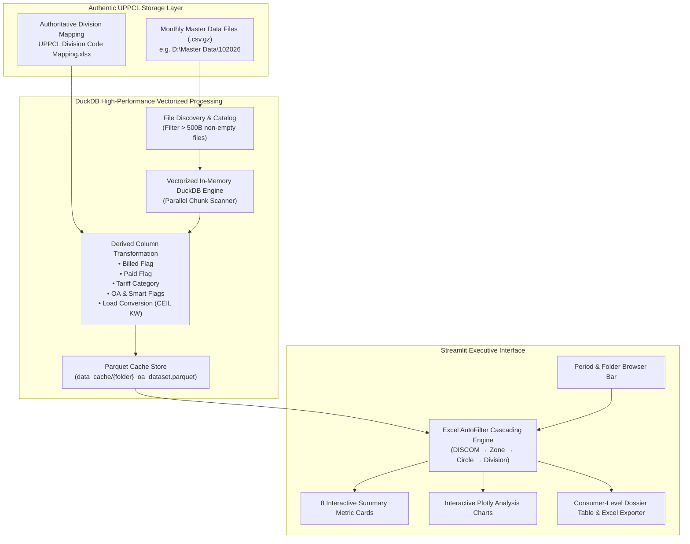

# Technical Design & User Operating Manual
## Open Access Consumers & Billing Revenue Analysis Dashboard

---

### 1. Architecture Overview



---

### 2. Data Schema & Derived Column Specifications

#### 2.1 Authentic 155 Source Columns
The system ingests all 155 authentic UPPCL master billing register fields without modification or truncation.

#### 2.2 Derived Column Formulas

| Derived Field | Source Column(s) | Business Logic / Formula | Output Values |
|---|---|---|---|
| `BILLED_FLAG` | `LAST_BILL_DATE` | Date parsing matching reference month and year | `Billed`, `Unbilled` |
| `PAID_FLAG` | `TOTAL_PAY_AMT` | Numerical check $> 0$ | `Paid`, `Unpaid` |
| `TARIFF_CATEGORY` | `SUPPLY_TYPE` | Strict ordered precedence matching: LMV-10, LMV-11, LMV-1..9, HV-1..4 | `LMV-1` to `LMV-11`, `HV-1` to `HV-4`, `Unknown` |
| `OA_CONFIG` | `MTR_CONFIG_TY_CD` | Case-insensitive substring match for `OA` | `YES`, `NO` |
| `SMART_METER_FLAG` | `CMPRESYS_CODE` | Case-insensitive substring match for `MD` | `YES`, `NO` |
| `LOAD_KW` | `LOAD`, `LOAD_UNIT` | $\lceil\text{CEIL}(\text{LOAD}) \times \text{Factor}\rceil$ where Factor: KW=1.0, KVA=0.9, BHP=0.746 | Integer KW value |
| `LOAD_RANGE` | `LOAD_KW` | Value binning | `1-4 KW`, `5-9 KW`, `10-24 KW`, `25-50 KW`, `Above 50 KW`, `Unknown/Invalid` |
| `DISCOM` | `DIV_CODE` | Authoritative mapping from `Major Divisions` | `DVVNL`, `KESCO`, `MVVNL`, `PuVVNL`, `PVVNL` |
| `ZONE_NAME` | `DIV_CODE` | Authoritative mapping | Zone string (e.g., `LUCKNOW`, `MEERUT`) |
| `CIRCLE_NAME` | `DIV_CODE` | Authoritative mapping | Circle string (e.g., `EDC AYODHYA`) |
| `DIVISION_NAME` | `DIV_CODE` | Authoritative mapping | Division name (e.g., `EUDD I GHAZIABAD`) |

---

### 3. Summary Calculations & Strict 1:1 Parity

All aggregations run against the active, filtered dataset:

1. **Total Number of Consumers:**
   $$\text{Total Consumers} = \text{COUNT}(\text{DISTINCT } \text{ACCT_ID}) \quad \forall \text{ ACCT_ID} \neq \emptyset$$
2. **Number of Billed Consumers:**
   $$\text{Billed Consumers} = \text{COUNT}(\text{DISTINCT } \text{ACCT_ID}) \quad \text{WHERE } \text{BILLED_FLAG} = \text{'Billed'}$$
3. **Sold Units (Consumption):**
   $$\text{Sold Units (kWh)} = \sum \text{CONSUMPTION\_CURR\_MNTH}, \quad \text{Sold Units (MU)} = \frac{\text{Sold Units (kWh)}}{1,000,000}$$
4. **Current Assessment:**
   $$\text{Current Assessment (₹)} = \sum \text{CURRENT\_ASSESSMENT}$$
5. **CA Excluding Subsidy:**
   $$\text{CA\_EX\_SUBS (₹)} = \sum \text{CA\_EX\_SUBS}$$
6. **Total Payment Count:**
   $$\text{Payment Count} = \text{COUNT}(*) \quad \text{WHERE } \text{PAID\_FLAG} = \text{'Paid'}$$
7. **Total Payment Amount:**
   $$\text{Payment Amount (₹)} = \sum \text{TOTAL\_PAY\_AMT}$$
8. **Total Outstanding:**
   $$\text{Total Outstanding (₹)} = \sum \text{TOTAL\_OUTSTANDING}$$

**Mandatory 1:1 Parity Rule:** When clicking any summary card or export button, the number of records displayed in the table and downloaded in the Excel/CSV file exactly equals the displayed consumer count.

---

### 4. User Operating Manual

#### 4.1 Launching the Application
Run the launcher script:
```powershell
run_dashboard.bat
```
Or execute directly:
```powershell
python -m streamlit run app.py --server.port 8503
```
Open a browser and navigate to `http://localhost:8503`.

#### 4.2 Selecting Master Data
1. **Browse Folder:** Click the **📂 Browse Folder** button to launch the native Windows folder picker, or type the path into the text input box (e.g., `D:\Master Data\102026`).
2. **Auto-Extracted Month & Year:** The dashboard automatically extracts the first 2 digits as the Master Month (e.g., `10` $\rightarrow$ October) and the last 4 digits as the Master Year (e.g., `2026`).
3. **Manual Override:** Expand the *🛠️ Manual Period Override* expander in the sidebar if manual corrections are needed.
4. **Load Data:** Click **🚀 Load Data** to ingest and process records.

#### 4.3 Navigating Filters
1. **Administrative Cascading:** Select DISCOM $\rightarrow$ Zone $\rightarrow$ Circle $\rightarrow$ Division in the sidebar. Options update dynamically.
2. **Operational Filters:** Toggle OPR_FLG, Tariff Category, Billed Flag, Paid Flag, OA Config, Smart Meter Flag, and Load Range.
3. **Reset Filters:** Click **🔄 Reset All Filters** to restore default settings.

#### 4.4 Drilldown & Exports
1. Click any summary indicator card (e.g., *Billed Consumers* or *Payment Realization*) to isolate those records in the consumer dossier table.
2. Search across accounts, consumer names, or division codes in the table search bar.
3. Choose a column visibility preset (*Standard Executive View*, *Billing & Financial*, *Technical & Metering*, or *All Columns*).
4. Click **📥 Download Filtered Records as Excel (.xlsx)** or **CSV** to save the authentic dataset.
