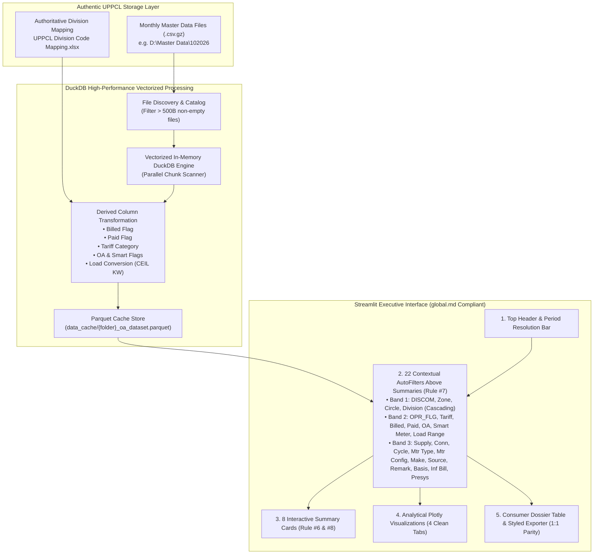

# Technical Design & User Operating Manual
## Open Access Consumers & Billing Revenue Analysis Dashboard (Version 3.0.0)

---

### 1. Architecture Overview & 22 Filter Structure



---

### 2. The 22 Filter Implementation (Rule #7)

All 22 filters requested in Sections 5.1 and 5.2 are rendered in 3 horizontal bands directly above the summary cards:

1. **Band 1 (4 Administrative Filters):** `DISCOM`, `Zone`, `Circle`, `Division` (Omnidirectional Cascading).
2. **Band 2 (7 Operational & Technical Filters):** `OPR_FLAG`, `Tariff Category`, `Billed Flag`, `Paid Flag`, `OA Config`, `Smart Meter Flag`, `Load Range`.
3. **Band 3 (11 Metering & Reading Profile Filters):** `SUPPLY_TYPE`, `TYPE_of_Connection`, `BILL_CYC_CD`, `MTR_TYPE_CD`, `MTR_CONFIG_TY_CD`, `MTR_MAKE`, `MR_SOURCE_CD`, `METER_READ_REMARK`, `BILL_BASIS`, `INF_BILL`, `PRESYS_CD`, alongside the universal **`🔄 Reset All 22 Filters`** action.

Each filter popover implements Microsoft Excel AutoFilter semantics:
- Top search input box.
- `(Select All Search Results)` checkbox when search text is active.
- `Add current selection to filter` checkbox for incremental searching.
- `(Select All)` master toggle when search is empty.
- Scrollable list with individual adjacent checkboxes for each unique option.
- Dynamic status badge `(All)`, `(3/10)`, `(None)`.

---

### 3. User Operating Manual

#### 3.1 Launching the Dashboard
Execute:
```powershell
d:\AG Project\Open Access\run_dashboard.bat
```
Or start via command line:
```powershell
python -m streamlit run app.py --server.port 8503
```
Open `http://localhost:8503` in your web browser.

#### 3.2 Operating All 22 Filters
1. Click any filter button in Band 1, Band 2, or Band 3.
2. Type in the search box to find specific entities (e.g. searching for a specific meter make, division, or tariff).
3. Use `(Select All Search Results)` or check/uncheck individual checkboxes.
4. Click **🔄 Reset All 22 Filters** to restore every filter to the default `(All)` state.

#### 3.3 Drilldown & 1:1 Parity Exports
1. Click **🔗 View All Consumers**, **🔗 Filter Billed Only**, **🔗 Filter Unbilled Only**, or **🔗 Filter Paying Only** on any summary card to filter the consumer dossier table.
2. Search across consumer names, account IDs, or division names.
3. Click **📥 Download Exact Records as Excel (.xlsx)** or **CSV** to save the authentic records matching the displayed summary count.
